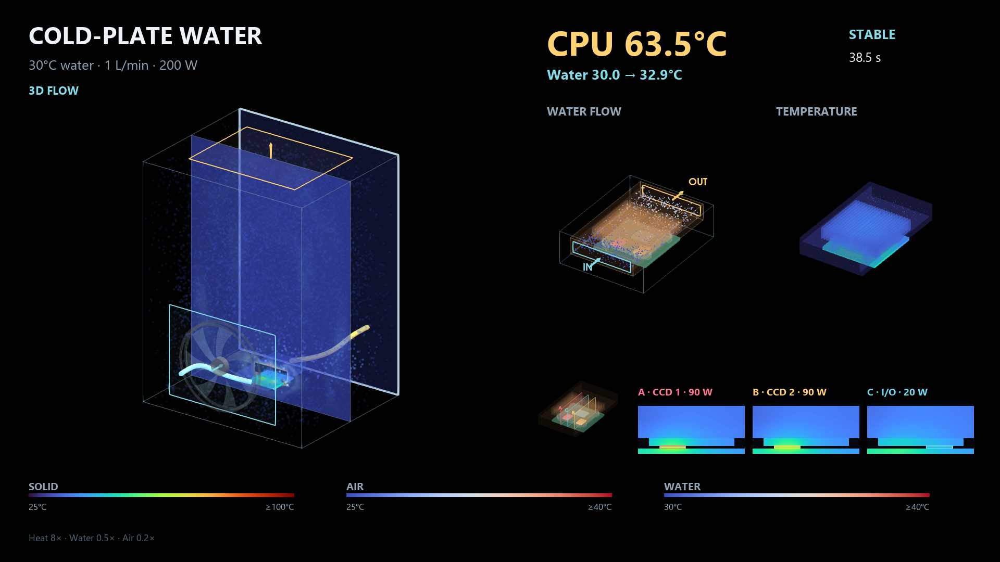

# Cold Plate Water

[Video summary](summary.mp4) · [Setup](case.json) · [Common runbook](../docs/RUNNING.md)

- Reference CPU temperature: **63.5 °C** at **38.5 s**.
- Endpoint: `CPU_temperature_settled`. Constant 200 W; no hardware throttling controller.
- Method: GPU LBM flow + finite-volume CHT; voxel bounce-back, not IBM.

From this directory: `python run.py --stage plan`, then `python run.py --stage setup`.
The source is shared in `../src/solver`; generated calculation files go to `../runs/cold_plate`.
See the common runbook before starting `--stage run` or changing parameters.
