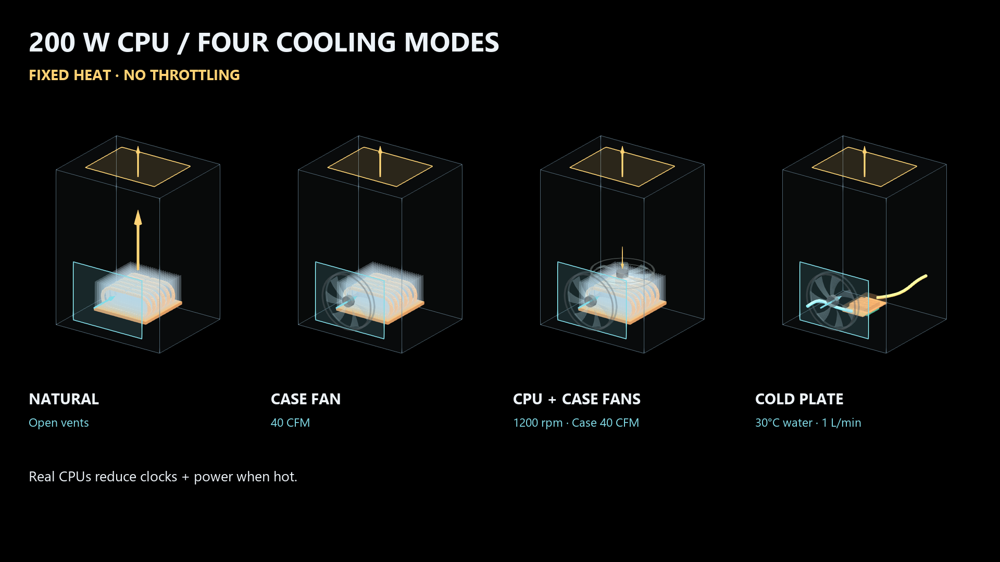
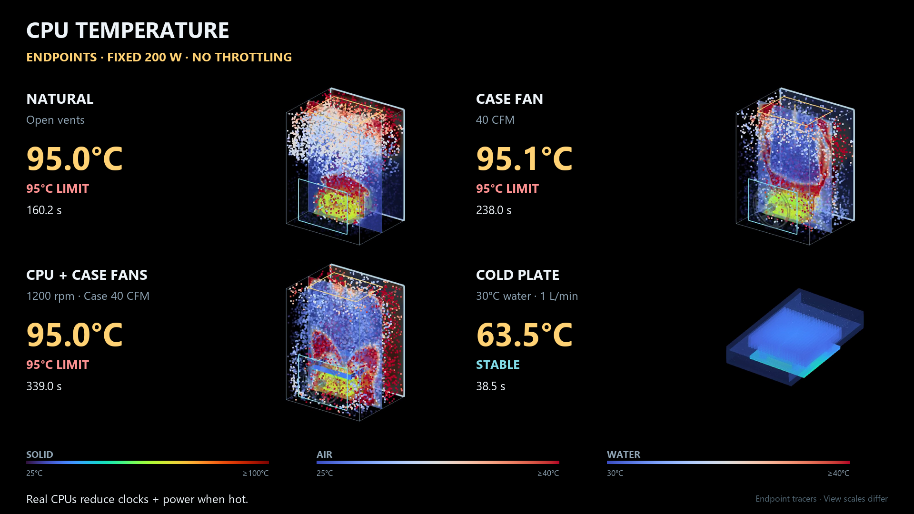

# GPU CPU cooling — LBM + CHT

Four **200 W CPU cooling demonstrations** built on [lbmpy](https://pypi.org/project/lbmpy/2.1.1/), [pystencils](https://pypi.org/project/pystencils/2.1/) and [CuPy](https://cupy.dev/): natural convection, case ventilation, CPU + case fans, and a water cold plate.

GPU lattice Boltzmann flow is coupled to conservative finite-volume heat transport on a Cartesian voxel grid. Solid boundaries use **NoSlip / bounce-back; IBM is not used**. The package is an AM5-inspired surrogate, not manufacturer internal CAD or a validated product prediction.

[Landscape video · 29 s](media/comparison_16x9.mp4) · [Portrait video · 32.5 s](media/comparison_9x16.mp4)



## Reference outcomes

| Case | Cooling condition | CPU endpoint | Physical heat time |
|---|---|---:|---:|
| Natural convection | Low/high openings; no fans | 95.0 °C limit | 160.2 s |
| Case ventilation | 40 CFM case through-flow | 95.1 °C limit | 238.0 s |
| CPU + case fans | 1200 rpm CPU fan; 40 CFM case flow | 95.0 °C limit | 339.0 s |
| Cold plate | 30 °C water inlet; 1 L/min | 63.5 °C, temperature settled | 38.5 s |

**Fixed 200 W, no throttling. Real CPUs reduce clocks and power when hot.**
Water outlet: approximately 32.86 °C. The four endpoints occur at different times; 95 °C is a stopping event, not a prediction of actual hardware shutdown.



## Repository layout

Case folder convention: `method_physics_resource_language_case`.

```text
LBM-FVM_CFD-incomp-CHT_GPU_Python_01-natural-convection/
LBM-FVM_CFD-incomp-CHT_GPU_Python_02-case-ventilation/
LBM-FVM_CFD-incomp-CHT_GPU_Python_03-cpu-and-case-fans/
LBM-FVM_CFD-incomp-CHT_GPU_Python_04-cold-plate-water/
src/solver/       Shared solver, geometry, materials and boundaries
assets/          Small generated STL surrogate and geometry description
tools/           Portable runners, package checks and local postprocessing
docs/            Runbook, numerical scope, sources and agent handoff
media/           Edited landscape/portrait comparisons
results/         Small reference summaries and temperature histories
```

`CFD-incomp` describes the low-Mach, incompressible-intent problem. The LBM implementation permits small density variations; this is not a compressible shock-flow solver. `Python` is the user-facing language; lbmpy/pystencils generate CUDA kernels and some operators use CUDA C kernels through CuPy.

**Excluded:** full solution fields, LBM populations, restart checkpoints, raw snapshot sequences, CUDA caches, virtual environments and the full calculation archive. The repository does not require access to the original workstation.

## Start on another workstation

Use Python 3.13, an NVIDIA CUDA-capable GPU and a compatible driver. The reference calculations used an RTX 5080 with 16 GB VRAM. A smaller GPU may require source-level grid/domain changes; adaptive mesh refinement is not implemented.

```sh
python -m venv .venv
# Activate .venv for your shell, then:
python -m pip install -r requirements.txt
python tools/verify_package.py
python tools/doctor.py
python tools/run_case.py --case natural --stage setup
python tools/run_case.py --case natural --stage smoke
python tools/run_case.py --case natural --stage plan
```

`plan` and `setup` do not start a long CFD run. Full runs are explicit and can take hours. See [RUNNING](docs/RUNNING.md) for all four cases, output locations and optional water/case-air coupling.

For a local coding agent, start with [AGENTS.md](AGENTS.md) and [AGENT_HANDOFF](docs/AGENT_HANDOFF.md).

## Reproduction scope

The archived natural-convection result uses coupled physical heat and flow. Forced-air heating uses a fixed sampled CFD field. The historical CPU-fan precursor was stopped before auxiliary thermal equilibrium; its valid velocity field was retained. Those large precursor fields are intentionally omitted.

This public package supplies a **bounded, isothermal cold-start flow preparation** for the forced-air cases. It makes a new machine runnable without hidden files, but does not promise identical temperatures/times to the archived warm-start results. See [NUMERICS](docs/NUMERICS.md), including the unresolved natural-case mass-flux diagnostic residual. No full four-case rerun was performed during packaging.

## Open-source basis and changes

- **lbmpy 2.1.1 / pystencils 2.1:** collision, streaming, boundary infrastructure and GPU code generation.
- **CuPy:** GPU arrays, CUDA kernels and sparse thermal solves.
- **Modifications and additions:** GPU-only initialization/output adapter, conjugate heat transport, contact resistance, six equivalent-conductance heatpipes, fan actuator, cold-plate geometry, case runners and visualization.
- **Portable packaging:** shared imports, repository-relative assets, generated-output isolation, cold-start forced-flow preparation and a local-agent runbook.

See [SOURCES](docs/SOURCES.md), [CHANGELOG](CHANGELOG.md) and [provenance.json](provenance.json). Upstream copyrights and license notices are retained. The inherited code is distributed under **GPL-3.0-or-later**, with [LICENSE](LICENSE) and [NOTICE](NOTICE.txt). Third-party dependencies are installed separately and retain their own licenses.
